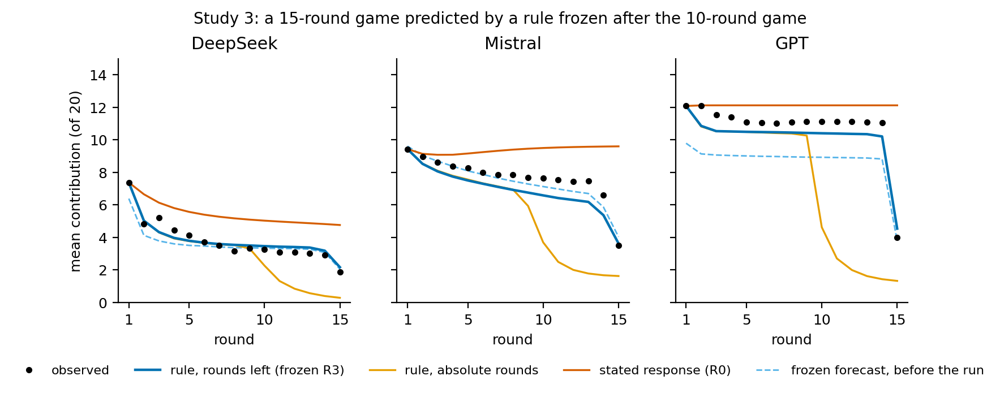
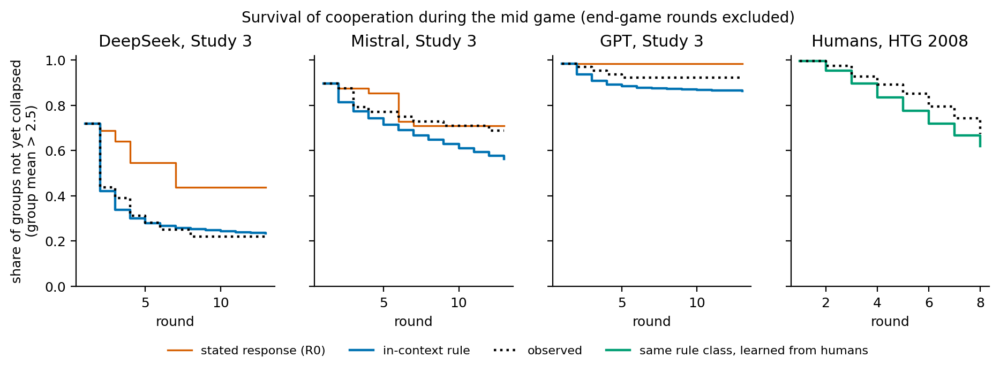
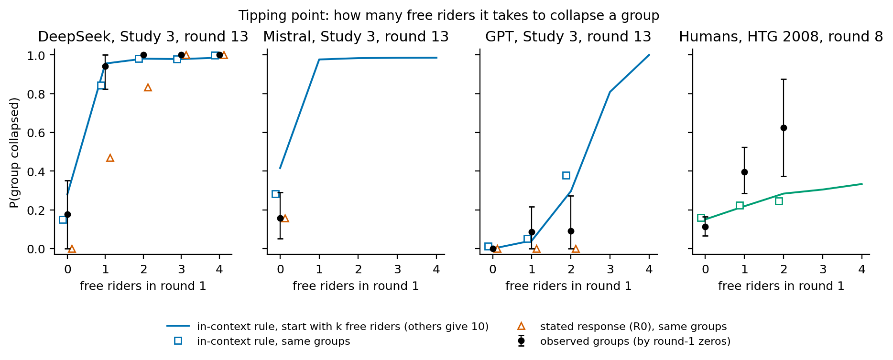
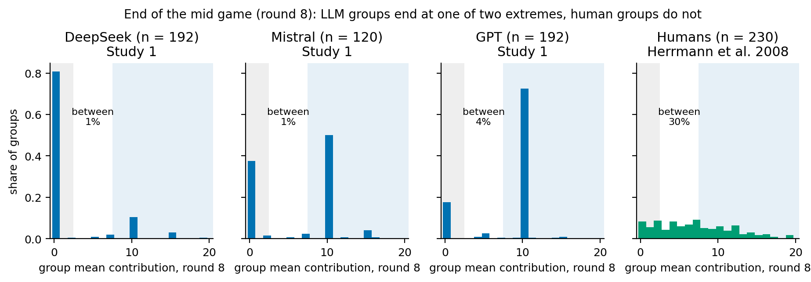
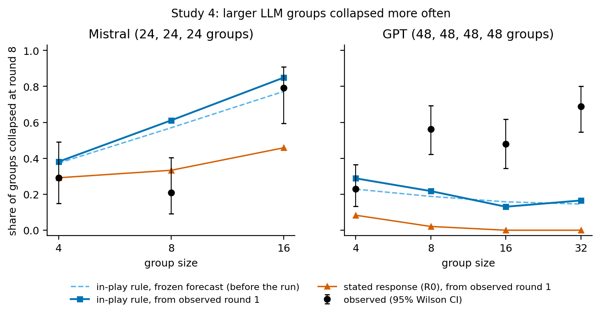
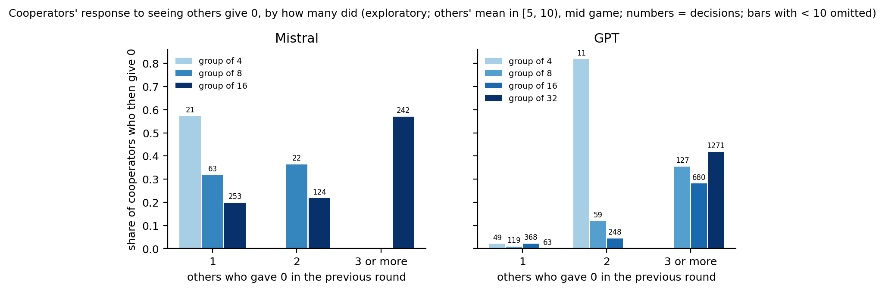

# Rules measured in play, not stated in isolation, generate the macro dynamics of LLM agent groups

Collapse traps, tipping points and pre-specified tests of time horizon and group size in a repeated public goods game with three language models

Gökhan Geyik 
<em>Empler AI</em> 
<code>gokhan@empler.ai</code> 
ORCID: <a href="https://orcid.org/0009-0000-9028-1827">0009-0000-9028-1827</a>

Preprint, version 2 (2026-10-22) 
<a href="https://doi.org/10.5281/zenodo.23574103">https://doi.org/10.5281/zenodo.23574103</a>

Plans, code, data and all decisions with reasoning texts are archived with this preprint under the DOI above. Every number is taken from the result files; most are printed by <code>paper/paper_numbers.py</code> (output <code>paper/numbers.md</code>), the rest are recorded in the dated plan amendments. Figures are drawn by <code>paper/figures.py</code>. Version 2 adds sources for the statement in Section 1 that LLM agents are commonly measured with questions asked in isolation; nothing else changed. Version 1: https://doi.org/10.5281/zenodo.23539451; all versions: https://doi.org/10.5281/zenodo.23539450.

---

## Abstract

Generative agent-based models use large language models (LLMs) as agents and often calibrate or validate them with questions asked in isolation. Whether such micro-level answers generate the macro-level dynamics of a population is the micro–macro question of agent-based social science. We study it in a repeated public goods game (20 points, MPCR 0.4) with three LLMs (DeepSeek-V4.1-Flash, Mistral-Large-4, GPT-6-Luna) in four studies (1,200 groups), each following a plan written before the data. A simulation built from each agent's stated response to an isolated question mispredicted group trajectories in all three models. A memory-one rule learned from in-game decisions in groups of four (own last contribution, the others' last average, whether someone gave 0, rounds left) reproduced the trajectories out of sample and, frozen in advance, predicted a 15-round game the agents had never played (mean error −0.06 to +0.82 points of 20). In exploratory analyses, the rule also generates the macro structure of four-agent groups: an absorbing collapse state, sticky cooperation, outcomes at the two extremes and, in two models, a tipping point at a single free rider. The stated responses imply averaging dynamics instead. In a pre-registered scaling test, with the forecast deposited publicly before the main run, both models collapsed more often in larger groups: Mistral 0.29 of groups at 4 agents and 0.79 at 16, GPT 0.23 at 4 and 0.69 at 32 (not monotonically in between). Started from each group's first round, the frozen rule predicted Mistral's increase (+0.47 against +0.50 observed; deposited forecast +0.40), partly through cancelling errors, but not GPT's (−0.12 against +0.46; deposited −0.08). Exploratory analyses point to two contributors: agents responded to how many, or what share, of the others defected rather than to whether anyone did (in groups of four, count and share coincide), and in large GPT groups defectors stayed at zero more often. A corrective rule using this information was stopped by a pre-specified gate (improvement 0.047 against a required 0.05); training the original rule on several group sizes helped more (exploratory). Human groups in the identical game (230 groups) occupy a different regime: collapse is escapable and outcomes are spread out. Identity descriptions, varied as a background manipulation, acted through their wording (value sentences and, for one model, an institutional fact) rather than the cities they named. For generative agent-based models the lessons are to measure micro rules in context and at the scales to be simulated. What an LLM agent says in isolation is a poor generator of what its group does, and a rule measured in small groups need not carry over to large ones.

---

## 1. Introduction

Agent-based social science explains a macro pattern by growing it from micro rules: a macro pattern counts as explained only if a population of agents following specified micro rules can generate it ("if you didn't grow it, you didn't explain it"; Epstein, 1999). Generative agent-based models (GABMs) replace hand-coded rules with language models prompted to play a role. The micro rules are then no longer written down; they have to be measured. A common way to measure them is to ask the agent what it would do in a described situation; studies that compare LLM agents with humans do this with survey items (Argyle et al., 2023; Park et al., 2024) and with one-shot decisions in economic games and classic experiments (Aher et al., 2023; Horton et al., 2023). This raises the micro–macro question in a new form: does what an LLM agent says in isolation generate what a population of such agents does?

For humans the public goods game gives a classic answer. Fischbacher, Gächter and Fehr (2001) elicited *contribution schedules* (what a person contributes for each possible average contribution of the others) and found about half of their subjects to be conditional cooperators and about a third free riders. Fischbacher and Gächter (2010) showed that such schedules, together with beliefs, account for the decline of cooperation in repeated play. Stated conditional rules connect the individual to the group.

For LLM agents the evidence is mixed:
- collective outcomes can look human-like while the underlying decision rules do not (Ferraz de Arruda et al., 2026);
- across open-weight models, agreement with human public-goods data held for first-round contributions but not for end states (Bin Tareaf, 2026);
- open models of one family (0.5–32B parameters) behave as static level-k players with little within-game updating (Teo, 2026);
- personas can override explicit payoffs (Manoranjan & Gaikwad, 2026) or carry across task narratives mainly through words that map onto actions (Wang, Lester & Srivastava, 2026).

In earlier work we found that the *wording* of an identity description, not the culture it names, set LLM agents' behaviour in the ultimatum game (Geyik, 2026a).

Collective behaviour is often governed by thresholds: whether an individual acts depends on how many others act, and small differences in a few individuals can tip a whole group (Granovetter, 1978). Whether a micro rule produces such thresholds, absorbing states or bimodal outcomes is a property of the macro dynamics. A rule can match average trajectories and still get these properties wrong. Such properties are typically derived by simulating the micro rules rather than read off them, which makes them "weakly emergent" in the sense of Bedau (1997).

We ask four questions:

1. **Micro to macro.** Does a population simulated from each agent's stated response to an isolated question reproduce real groups? If not, does a rule learned in play do so out of sample, and does it predict, frozen in advance, a game the agents have never played?
2. **Macro structure.** Which collective properties does each rule generate (absorbing states, tipping points, the distribution of end states), and which does it get right? How do LLM groups compare with human groups in the identical game?
3. **Scale.** Does a rule measured in groups of four predict how collective outcomes change as groups grow to 8, 16 and 32 agents?
4. **Identity (background).** Do identity descriptions (city names, value sentences, institutional facts) change contributions in the direction of the human cross-cultural ranking (Herrmann, Thöni & Gächter, 2008)?

Our contributions:
- (i) one-shot stated responses mispredict group dynamics in all three models;
- (ii) a minimal in-context rule, designed after Studies 1 and 2, closes the gap and, frozen in advance, predicts a game of unseen length;
- (iii) in exploratory analyses, the in-context rule generates a threshold system with an absorbing collapse state, which the stated responses miss and which differs from the human regime;
- (iv) in both models tested, LLM groups collapsed more often when they were larger; a rule from groups of four predicted this for one model but not the other, and exploratory analyses suggest two contributors (agents respond to how many, or what share, of the others defect, and in large GPT groups defectors stayed at zero);
- (v) identity effects come from the wording of the descriptions (value sentences; for Mistral also the court-time fact), not from city names;
- (vi) pre-specified tests went against parts of our own accounts: the "visible free rider" mechanism was not supported in two of three models, and the predicted opposite scaling of the two models was not confirmed (both models scaled the same way).

All plans, amendments, code, data and reasoning texts are open.

## 2. Method

### 2.1 Game and models

Groups of four homogeneous agents (all four receive the same identity card) play a linear public goods game:
- each round every player receives 20 points and contributes a whole number from 0 to 20;
- each contributed point yields 0.4 points to each player;
- after each round, players see every player's contribution and their own earnings;
- there is no punishment.

Before play, each agent answers two rule-check questions (correct answers 28 and −6).

Three models were each pinned to one provider through OpenRouter:
- `deepseek/deepseek-v4.1-flash` (DeepInfra, fp8);
- `mistralai/mistral-large-4-0` (Mistral);
- `openai/gpt-6-luna` (OpenAI).

Model snapshots were logged on every call and did not change across the studies. Temperature and reasoning effort were left at provider defaults; `max_tokens` was 16,000. Answers were requested as a JSON object with a contribution and a one- or two-sentence rationale; invalid answers were re-requested and counted, never coded.

### 2.2 Identity cards

Twelve cards: four cities (Boston, Copenhagen, Athens, Riyadh) × three styles.
- *Minimal:* "You are a 21-year-old university student living in {city}."
- *Value:* minimal + one value sentence (e.g. Boston: "Where you grew up, people prize personal liberty and speaking up against authority."; Riyadh: "…people strongly respect family elders and tribal leaders.").
- *Factual:* minimal + "In your country, a lawsuit over an unpaid bill takes about N days" (contract-enforcement time in Doing Business 2020, World Bank, 2019: 444, 485, 1,711, 575).

The system message read "The following describes you:" followed by the card (for Mistral, the provider apparently added a JSON-format instruction; see Limitations). Cities were chosen so that their human ranking in Herrmann et al. (2008) is known (rounds 1–10: Copenhagen > Boston > Riyadh > Athens).

### 2.3 Two micro rules

**Stated response (R0).** In a separate arm, agents with the same card answered single questions: "This is round 5 of 10. In the previous round the other 3 players of your group contributed, on average, X points each" for X ∈ {0, 5, 10, 15, 20}, four repetitions. The cell's mean answers define a piecewise-linear function f. In the R0 model every agent contributes c_i,t = f(c̄_−i,t−1), where c̄_−i is the others' previous average. This is the LLM analogue of a contribution schedule, and it is deterministic.

**In-context rule (R3).** The agent's state combines four parts:
- its own previous contribution (bins 0, 1–9, 10, 11–19, 20);
- the others' previous average (0, (0, 5), [5, 10), 10, (10, 15), [15, 20]);
- whether one of the others gave 0;
- the rounds left (≥ 2, second-to-last, last).

In each state the agent draws one of the real decisions observed in that state in the training groups. This keeps the 0/10/20 discreteness of real decisions. Unseen states back off to coarser states and to the model's other cards. The group process is a Markov chain on the four contributions. In the mid game (two or more rounds left) it is time-homogeneous, which makes its long-run properties well defined. R3 was designed after the results of Studies 1 and 2 were known (Section 4) and frozen before Study 3 (Section 6).

### 2.4 Human reference data

Herrmann, Thöni and Gächter (2008) ran the identical game: groups of four with fixed membership, 20 tokens, MPCR 0.4 and 10 periods. Their "N experiment" has no punishment. We use the N experiment from the sessions in which it was played first: 230 groups in 16 cities. The data are public (Herrmann, Thöni & Gächter, 2017, Dryad). The same in-context rule class was fitted to these data (in sample) as a reference.

### 2.5 Macro measures

A group is **collapsed** (in the collapse region) when its mean contribution is ≤ 2.5 and **cooperative** when it is ≥ 7.5; values in between count as *between*. The thresholds are fixed in the plan; a 1/9 sensitivity check applies to the end-state shares.

We measure five properties:
- **Persistence** of the symmetric states all-0, all-10 and all-20: the probability that the group repeats the state in the next round (p = π⁴, where π is the agent-level probability).
- **Lifetime** of cooperation: the number of rounds from all-10 to the first collapse under the mid-game rule.
- **Tipping point** k*: the smallest number of round-1 free riders (the other 4 − k give 10) for which the group is in the collapse region at round 13 with probability ≥ 0.5.
- **Recovery**: the share of collapsed groups that later return to cooperation.
- **End-state distribution**: collapsed / between / cooperative at the end of the mid game (round 8 of 10, round 13 of 15).

Observed values are compared with each rule's prediction for the same groups, started from their observed round 1. Three labels are used (for the in-context rule; no intervals were computed for R0):
- an observed − predicted difference within ±0.15, with its CI inside the band, counts as "reproduced";
- a CI wholly outside the band counts as "deviates";
- anything else counts as "unclear".

### 2.6 Process

Every study followed a written plan made before its data. For Studies 2–4 the plan was committed to the git repository before any paid call. For Study 1 it was written and approved before any call but committed on 2026-10-12, a day after a small paid format check (stage 0a) whose data are not analysed, and before the plumbing check (stage 0b) and the main run. Each plan contained hypotheses with both directions, decision rules and analysis code tested on synthetic data. Analysis scripts refuse to run on incomplete data. Exploratory analyses were also planned in writing before they were computed; deviations are recorded as dated amendments with their reason. The plans are written in Turkish; they are internal written plans in a public repository, not entries in a public registry, and we call them pre-specified. Only the plan and forecast of Study 4 were also deposited publicly before its main run; we call that test pre-registered. In the plans and the archive, Study 1 is the main experiment, Studies 2, 3 and 4 are Experiments A, B and C, and the stopped 64-agent test is Experiment D.

A difference counts as present when its point estimate exceeds 2 points and its group-level bootstrap 95% CI excludes 0 (10,000 resamples). Holm correction is applied within model and hypothesis family where a family has several tests.

The research was carried out with an AI assistant (Claude) under the author's direction. Every number was taken from the result files, and the key ones were recomputed with independent code. Numbers are rounded half up from exact values. References were checked against Crossref, DataCite or arXiv records (arXiv preprints at the level of their abstracts).

## 3. Study 1: the stated-response gap

**Design.**
- 12 cards × 3 models; 16 groups per cell for DeepSeek and GPT, 10 for Mistral (504 groups, 10 rounds).
- 144 isolated schedules.
- 23,040 answers in total; cost 45.34 USD.
- Rule checks were answered correctly by 816/816 (DeepSeek), 528/528 (Mistral) and 811/816 (GPT) agents.

### 3.1 The stated-response gap

For each cell we simulated, from each real group's round-1 contributions, a group in which every agent follows R0. Real groups contributed less than these simulations in 13 of 36 cells and more in none (mean gap −1.64, −1.53, −2.17 points; negative in 32 of 36 cells).

The stated responses were close to "give what the others gave": GPT's average stated response equalled X at every point in 10 of its 12 cells. In an exploratory analysis, the gap persisted for DeepSeek and Mistral when the last two rounds were excluded (rounds 2–8: 3 and 5 cells below; GPT 0).

### 3.2 Identity and interaction (summary; details in Supplement S1–S2)

Identity descriptions were the manipulated background of Study 1. City names alone made no detectable difference: with minimal cards no city pair differed in any model (largest |difference| 1.02, 1.54 and 2.22 points). Value sentences moved contributions by up to 14.45 points, in the direction of their wording rather than the cities' human ranking (Table 1). In DeepSeek and Mistral the Boston value card ("personal liberty and speaking up against authority") produced near-zero contributions (0.15 and 0.20) and the Riyadh value card ("respect family elders and tribal leaders") the highest of all cards (13.06 and 14.65), the reverse of the human order. The court-time fact mattered only for Mistral (Athens 1.59 against 5.51–7.81 for the other factual cards). DeepSeek and Mistral often read the card as a cue from the experimenter. Of 36 pre-specified interaction tests, 4 differences grew in play, 10 faded and 22 were preserved; in GPT the growth came entirely from the last round.

**Table 1.** Mean contribution over ten rounds (of 20), value and minimal cards.

| | Boston | Copenhagen | Athens | Riyadh |
|---|---:|---:|---:|---:|
| DeepSeek, minimal | 0.61 | 1.63 | 1.47 | 1.45 |
| DeepSeek, value | 0.15 | 9.26 | 1.94 | 13.06 |
| Mistral, minimal | 6.03 | 7.56 | 6.76 | 7.29 |
| Mistral, value | 0.20 | 10.11 | 10.42 | 14.65 |
| GPT, minimal | 7.81 | 8.17 | 7.90 | 5.96 |
| GPT, value | 8.91 | 11.28 | 9.08 | 9.25 |
| Humans, N experiment, periods 1–10 (Herrmann et al.) | 9.33 | 11.53 | 6.36 | 7.63 |

## 4. Learning the micro rule in play (exploratory)

These analyses are exploratory; each was written down before it was computed. The two regularities below were noted after Study 1 and motivated Study 2; the rules R1–R3 were designed after the results of Study 2 were also known.

Two regularities stood out:
1. **Contributions were focal.** Of the 20,160 individual decisions, 96.0% were exactly 0, 10 or 20.
2. **A visible zero-contributor was followed by defection.** We looked at decisions in rounds 2–9 where the agent had itself contributed ≥ 10 in the previous round and the others' average was ≥ 5. When one of the others had given 0, the agent contributed 0 in 65% (DeepSeek), 61% (Mistral) and 15% (GPT) of cases; when none had, in 2%, 3% and 0%.

The isolated question shows only an average, so R0 cannot represent this. We therefore learned rules of increasing richness from the group data:
- R1: own and others' previous contributions;
- R2: R1 + whether one of the others gave 0;
- R3: R2 + rounds left.

We evaluated them by leave-one-group-out cross-validation in Study 1 and, without refitting, on the independent arm-B groups of Study 2 (same prompt, a new run started three days later; the rules were not fitted to these groups, but their aggregate results were known when the rules were designed; Table 2).

**Table 2.** Trajectory RMSE (points), stated response (R0) vs rules learned in play.

| | R0 stated | R1 own + others | R2 + zero | R3 + rounds left |
|---|---:|---:|---:|---:|
| DeepSeek, Study 1 (cross-validated) | 2.01 | 0.76 | 0.66 | **0.41** |
| Mistral, Study 1 | 3.76 | 2.05 | 2.03 | **0.58** |
| GPT, Study 1 | 3.04 | 1.83 | 1.81 | **0.44** |
| DeepSeek, new run | 2.10 | 0.42 | 0.40 | **0.41** |
| Mistral, new run | 4.34 | 3.14 | 3.17 | **0.76** |
| GPT, new run | 2.83 | 2.16 | 2.00 | **0.67** |

Bold marks R3, the rule used in the rest of the paper; in DeepSeek's new run R2 was marginally lower.

R3 matched every one of the 36 Study 1 cells and the 12 new-run cells (no cell above or below). What was missing differed by model:
- for DeepSeek, in-game behaviour itself: R1 already sufficed, and in play DeepSeek is far less cooperative than its stated "match the others";
- for Mistral and GPT, the horizon: without the rounds-left state, simulations fell below the real groups (mean gap, observed − simulated, +1.58 for Mistral and +0.61 for GPT with R1).

## 5. Study 2: does seeing the free rider cause the collapse?

The counting in Section 4 suggested a mechanism, which we tested with a pre-specified manipulation of feedback:
- arm B showed every player's contribution (the Study 1 prompt);
- arm T showed only the agent's own contribution and the others' average.

Four minimal cards; 12, 8 and 12 groups per cell (256 groups); 23.81 USD. Arm B reproduced the Study 1 minimal cells in 11 of 12 cells (|difference| ≤ 2).

**Primary hypothesis: not supported in any model.** The hypothesis was that visibility speeds the collapse (rounds 2–9, T − B > 2). Results:
- DeepSeek +0.43 [−0.21, +0.98], equivalent to no difference;
- Mistral −1.65 [−3.12, −0.14];
- GPT −1.98 [−3.55, −0.42].

The latter two point the other way but stay below the 2-point threshold.

**Mechanism test: supported only for DeepSeek.** The test compared the share of 0 after a zero-contributor, in the same true state in both arms:
- DeepSeek 0.88 with visible zeros vs 0.58 without (−0.31 [−0.53, −0.08]);
- Mistral 0.60 vs 0.56, no difference;
- GPT 0.13 vs 0.04, no difference.

Without individual information Mistral groups decayed faster, consistent with agents reacting to the lower average. GPT's arms differed already in round 1, before any feedback (−1.77 [−3.13, −0.42]): the rewording of one rule sentence lowered its opening contribution, so its T − B difference mostly reflects the prompt rather than visibility.

## 6. Study 3: predicting a game the rule has never seen

To test the learned rule forward, we froze R3 (tables learned from Study 1 only; file hash in the plan) and computed its forecast for a 15-round game before any call. The prompt differed from Study 1 only in the number of rounds. A rival variant, R3-absolute, maps rounds by their absolute number as in training (rounds 9 and 10 as end game) and therefore predicts an early collapse. Eight cards (minimal and value), 8, 6 and 8 groups per cell (176 groups); 23.08 USD billed.

**Pre-specified results.** Starting each group from its observed round 1, the frozen rule predicted rounds 2–15 within the equivalence band in all models (Table 3, Figure 1), with 23 of 24 cells consistent. In rounds 9–13 the absolute-round variant was wrong by +4.38 (Mistral) and +6.87 (GPT) points: real groups did not collapse early. Mistral and GPT therefore "track the announced horizon". For DeepSeek the same error was smaller (+1.49 [+0.82, +2.18]) and the test did not discriminate.

**Table 3.** Study 3: observed minus predicted (rounds 2–15) and trajectory RMSE.

| | observed − predicted, rounds 2–15 [95% CI] | label | RMSE R3 | R3-absolute | R1 | R0 stated |
|---|---|---|---:|---:|---:|---:|
| DeepSeek | −0.06 [−0.60, +0.48] | holds (tight) | **0.37** | 1.35 | 0.81 | 1.83 |
| Mistral | +0.82 [+0.17, +1.52] | holds | **0.89** | 3.13 | 2.82 | 2.29 |
| GPT | +0.67 [−0.17, +1.46] | holds | **0.77** | 5.29 | 2.92 | 2.36 |

The unconditional forecast written before the run (round 1 drawn from Study 1) had RMSE 0.53, 0.45 and 2.19. GPT's larger error comes from round 1: in the longer game GPT opened higher (12.1) than in Study 1 (forecast 9.8).

**Figure 1.** Study 3. Mean contribution per round (averaged over the eight cards) against four predictions:
- the frozen rule started from each group's observed round 1 (rounds left);
- the same rule with absolute round numbers;
- the stated response (R0);
- the unconditional forecast written before the run.

## 7. Macro structure: traps, tipping points and end states (exploratory)

Sections 4 and 6 show that R3 reproduces mean trajectories. Here we ask whether it also generates the macro structure of the groups, and what R0 implies instead. The plan (`prereg/prereg_dyn.md`), including its reading rules, was written and committed after all earlier results were known but before any quantity in this section was computed. One deviation was recorded before reporting: within the free-rider classes the card-stratified bootstrap gave zero-width intervals and was replaced by an unstratified one, which widened them. We use the frozen R3 tables throughout. Comparisons on Study 1 are in sample for R3; Study 2 (arm B) and Study 3 are out of sample.

**Table 4.** Macro structure. Rule properties (model-level rule, mid game) and observed out-of-sample values.

| | DeepSeek | Mistral | GPT | Humans |
|---|---:|---:|---:|---:|
| All-0 repeats itself, per round (rule) | 0.95 | 0.92 | 1.00 | 0.32 |
| All-10 repeats itself, per round (rule) | 0.96 | 0.95 | 1.00 | 0.00 ᵃ |
| Rounds from all-10 to collapse, median (rule) | 25 | 15 | > 100 ᵇ | 13 |
| In the collapse region at round 13, no free rider (rule) | 0.28 | 0.42 | 0.00 | 0.19 |
| In the collapse region at round 13, one free rider (rule) | 0.96 | 0.98 | 0.04 | 0.23 |
| Tipping point k* (rule) | 1 | 1 | 3 ᶜ | none |
| Collapsed groups that returned to cooperation (observed, Study 2 / Study 3) | 0.02 / 0.06 | 0.00 / 0.00 | 0.08 / 0.00 | 0.19 |
| Groups ending in between (observed, Study 2 / Study 3) | 0.02 / 0.02 | 0.00 / 0.02 | 0.02 / 0.03 | 0.30 |

Notes:
- Human column: the same rule class learned from the human groups (in sample); observed values from the human groups at period 8. The rule rows run the human rule to round 13, beyond the 10-period game; at period 8 the two collapse shares are 0.15 and 0.22.
- ᵃ All-10 is nearly absent in human data (1 transition).
- ᵇ 99% of simulated groups had not collapsed after 100 rounds.
- ᶜ Boundary case: with three free riders the start (0, 0, 0, 10) has mean 2.5 and already counts as collapsed.
- Numbers of collapsed groups behind the recovery shares: 47 / 50, 10 / 15 and 13 / 5 (Study 2 / Study 3, DeepSeek / Mistral / GPT); 59 for humans.

### 7.1 Collapse is a trap; cooperation is sticky

In all three models the all-0 state is close to absorbing. Under the rule it repeats itself with probability 0.92–1.00 per round. In the observed LLM groups the per-round persistence was 0.93–1.00 in every data set, and almost no collapsed group came back (Table 4). Cooperation is also sticky: all-10 repeats itself with probability 0.95–1.00, and under the mid-game rule a cooperative group survives a median of 25 (DeepSeek) and 15 (Mistral) rounds and, for GPT, more than 100.

The rule reproduced the share of groups not yet collapsed at the end of the mid game in Study 2 and Study 3 for DeepSeek and GPT (Figure 2 shows Study 3). For Mistral the comparison was unclear in both: in Study 2 the difference was +0.08 [−0.06, +0.20], and in the 15-round game cooperation lasted longer than the rule predicts: 0.69 of groups had not collapsed by round 13, against 0.56 predicted (difference +0.12 [+0.04, +0.21], unclear).

**Figure 2.** Share of groups not yet collapsed (group mean > 2.5) during the mid game, observed and predicted for the same groups from their round 1 by the in-context rule and, in the LLM panels, by the stated response (R0). LLM panels: Study 3, out of sample; human panel: rule learned from the same data.

### 7.2 One free rider tips a group (DeepSeek, Mistral), not GPT

Starting with k agents at 0 and the other 4 − k at 10, the rule turns a mostly surviving group into a collapsed one at k = 1 for DeepSeek (0.28 → 0.96 in the collapse region at round 13) and Mistral (0.42 → 0.98). Here the start (0, 10, 10, 10) has mean 7.5, so the tipping happens during play. For GPT the curve is gradual: 0.04 with one free rider and 0.30 with two. Its k* = 3 is a boundary case, because a start with three zeros already counts as collapsed (0.81 stay collapsed). Cell by cell, k* was 1 in 8 of 12 DeepSeek cells and 6 of 12 Mistral cells, and 2–3 in 11 of 12 GPT cells.

The real groups of Study 3 (out of sample) show the pattern, but the free-rider classes are small (Figure 3). Of the nine classes with at least five groups, four were "reproduced" by our ±0.15 rule (DeepSeek with 2–4 zeros, GPT with none), five were "unclear" and none "deviates". For DeepSeek's groups with one round-1 zero (17 groups), the share in the collapse region at round 13 was 0.94 observed, 0.84 under the in-context rule and 0.47 under R0; for GPT's groups with two round-1 zeros (11 groups) it was 0.09, 0.38 and 0.00.

- Mistral had only 4 Study 3 groups with k1 = 1. In Study 1 and Study 2 all Mistral groups with k1 = 1 were in the collapse region at round 8 (9 and 5 groups), against R0 predictions of 0.56 and 0.40.
- For GPT's k1 = 2 groups in Study 3, R0 (0.00) came closer than the rule (0.38) to the observed 0.09. In Study 1 the same class gave 0.44 observed, 0.29 for the rule and 0.00 for R0.

**Figure 3.** Tipping point: share of groups in the collapse region at round 13 (LLMs, Study 3) or period 8 (humans).
- Lines: the model-level in-context rule from an idealised start (k agents at 0, the others at 10); for humans, the rule pooled over the human groups.
- Markers: the real groups, grouped by their number of round-1 zeros (classes with ≥ 5 groups). They show the observed share with its 95% CI and the mean prediction for the same groups of the cell-level in-context rule (pooled human rule for humans) and of the stated response (no stated responses exist for humans).

### 7.3 Two-ended outcomes and path dependence

LLM groups ended the mid game at one of the extremes (Figure 4). The share of groups in between at round 8 of Study 1 was:
- 1% (DeepSeek), 1% (Mistral) and 4% (GPT);
- under the rule for the same groups 2%, 2% and 5%;
- under R0, 16%, 2% and 19%.

Out of sample, the rule reproduced all three end-state shares in Study 2 and Study 3 for DeepSeek and GPT (12 of 12 comparisons). For Mistral it reproduced the share in between but over-predicted collapse (Study 3: 0.43 predicted, 0.29 observed; unclear). With the stricter 1/9 thresholds all labels were unchanged; the share in between rose to 2–9% for LLM groups and 53% for humans.

Our pre-written reading rule for "two attractors" had three parts: both symmetric states sticky under the rule, fewer than 20% of groups in between, and at least 10% at each extreme, in both Study 2 and Study 3. Only Mistral met it. DeepSeek failed because in Study 2 only 2% of its groups ended cooperative (most had a zero in round 1). GPT failed because in Study 3 only 8% ended collapsed. The rule is two-sided in all three models; which side the groups end on depends largely on how they start.

Both extremes occurred within the same cell in 3 (DeepSeek), 7 (Mistral) and 8 (GPT) of the 12 Study 1 cells. Identical starts led to different ends: of the 65 Mistral groups in which all four agents opened with 10, 22% were in the collapse region at round 8 and 77% were cooperating (rule: 28%). Under the rule, the end was undecided at the start (collapse probability between 0.2 and 0.8) for 35–59% of Mistral groups, 14–22% of GPT groups and 2–9% of DeepSeek groups.

**Figure 4.** Group mean contribution in round 8. LLM groups: Study 1, all cards. Humans: N experiment of Herrmann et al. (2008), sessions in which it was played first.

### 7.4 What the stated responses imply instead

The stated-response map R0 is close to "match the others' average". In 12, 5 and 12 of the 12 cells (DeepSeek, Mistral, GPT) it has a segment on which f(x) = x. In no cell does it have two separated stable states. Such a map averages: mixed groups converge toward an intermediate level, and one free rider pulls the group down in proportion rather than past a threshold. Hence R0 predicts more intermediate outcomes than observed for DeepSeek and GPT (11–23% vs 1–4%) and too little collapse after a single free rider (DeepSeek, Study 1: 0.36 vs 0.82 observed). For GPT, R0 lets no group with one or two free riders collapse, in any cell; in Study 1, 0.44 of the GPT groups with two round-1 zeros collapsed.

By our pre-written reading rule (number of stable states and tipping point of the model-level map), R0 mispredicts the macro structure in all three models. The rule is coarse. For Mistral the tipping-point part rests on a boundary case: the model-level map reaches a group mean of 2.497 at round 13, just under the 2.5 threshold. The conclusion holds without it, because the model-level map has one stable state against the rule's two sticky states.

For Mistral the picture is mixed. Its stated responses came close to the share of groups not yet collapsed at the end of Study 3 (0.71 vs 0.69 observed; no interval was computed for R0). They were also closer than R3 to the collapse and cooperative shares in Study 2 and Study 3 (Study 3 collapse: R0 0.29, observed 0.29, R3 0.43). R3 was closer on the share in between. The stated responses missed the response to a single free rider and the level of cooperation (Table 3).

### 7.5 Human groups occupy a different regime

In the identical game, human groups behave differently on every measure:
- collapse is not a trap: an all-0 human group repeated itself in 9 of 22 observed transitions (0.41), and 61% of collapsed human groups left the collapse region later (19% reached cooperation);
- end states are spread out: 30% of groups ended in between (Figure 4);
- round-1 free riders lowered outcomes gradually: 11%, 40% and 63% of groups with 0, 1 and 2 round-1 zeros were in the collapse region at period 8.

The same memory-one rule class fitted to the human data matched the survival curve and the end-state shares within ±0.15 (in sample; descriptive, as no labels were pre-specified for humans), but not the free-rider gradient. It predicted 0.23 and 0.25 for one and two round-1 zeros, against 0.40 and 0.63 observed. One possible reason, which we did not test, is persistent differences between people, such as free-rider types (about a third of the subjects in Fischbacher et al., 2001). A rule pooled over people and remembering one round cannot carry this information. LLM groups consist of identical agents, and for them the pooled memory-one rule sufficed.

## 8. Study 4: how do groups scale? (prospective)

Every result so far concerns groups of four. A complexity reader's first objection is that four agents are not a large system. The in-context rule is defined by size-free features (own previous contribution, the others' average, whether one of the others gave 0, rounds left), so it predicts behaviour at any group size n without refitting. One feature is sensitive to size: with n − 1 others, the chance that at least one of them gives 0 grows with n. We therefore asked the frozen rule, before any data, how outcomes change from 4 to 8, 16 and 32 agents.

**Design** (plan `prereg/prereg_expC.md`, approved and committed before any paid call).
- Groups of 4, 8, 16 and 32 for GPT (48 groups per size) and of 4, 8 and 16 for Mistral (24 groups per size).
- Four minimal cards and 10 rounds. The groups of four are a concurrent control.
- The prompt is that of Study 1 except the number of players. The rule-check example lists the other players, so it grows with n.
- DeepSeek was not included: with minimal cards its groups collapse almost always even at n = 4, so a size effect could not show.

**Frozen forecast** (`data/expC/forecast_v1.json`, sha256 `00d88e05…be9df`; Table 5). The plan and the forecast were deposited publicly before the main run (Geyik, 2026b). The in-play rule predicts opposite scaling in the two models:
- Mistral groups end in the collapse region more often as they grow (0.37 → 0.57 → 0.77 at round 8);
- GPT groups do not (0.23 → 0.19 → 0.16 → 0.15).

The stated responses (R0) predict no size effect for Mistral in the frozen forecast (0.30 → 0.31). We did not test human groups of different sizes.

**Table 5.** Frozen forecast: share of groups in the collapse region at round 8 (mean over the four minimal cards).

| model | rule | n = 4 | n = 8 | n = 16 | n = 32 |
|---|---|---:|---:|---:|---:|
| Mistral | in-play rule (R3) | 0.373 | 0.570 | 0.772 | — |
| Mistral | stated response (R0) | 0.297 | 0.298 | 0.311 | — |
| GPT | in-play rule (R3) | 0.228 | 0.188 | 0.158 | 0.146 |
| GPT | stated response (R0) | 0.063 | 0.013 | 0.000 | 0.000 |

**Pre-registered tests.**
- **C-H1, direction of the size effect (primary):** the share collapsed at round 8, largest n minus n = 4. Labels: "increase", "decrease", "no change" (CI within ±0.10) or "unclear". "Opposite scaling confirmed" is written only if Mistral shows an increase and GPT does not.
- **C-H2, transfer (primary):** the frozen rule's prediction of mean contribution at each size, started from each group's observed round 1, with the equivalence band of Study 3.
- **C-H3, macro transfer (secondary):** the share collapsed at each size, ±0.15 band.
- **C-H4, curve (descriptive):** outcome against log₂ n.
- **Mechanism:** the share of defection after a visible zero, by group size. It measures whether the zero trigger survives in a crowd ("one of 31") or fades.

**Results** (`results/expC_main_20261020_analysis.json`; 264 groups, 56.67 USD; Figure 5). Every run completed; no invalid answers (4 GPT answers that could not be parsed were re-requested); model versions as before.

- **Both models collapsed more often in larger groups (C-H1 "increase" in both; not monotonic in between).**
  - Mistral: 0.29 of groups at n = 4, 0.21 at 8 and 0.79 at 16 were in the collapse region at round 8; 16 − 4 = +0.50 [+0.29, +0.71].
  - GPT: 0.23, 0.56, 0.48 and 0.69 at n = 4, 8, 16 and 32; 32 − 4 = +0.46 [+0.29, +0.63].
  - The labels were the same against the historical four-agent groups of Studies 1–2.
- **Mistral: the forecast held in direction and size (partly through cancelling errors; see below).** The rule predicted +0.47 from the groups' observed round 1 (+0.40 in the frozen forecast), inside the CI; the stated responses, started from the same first rounds, predicted +0.17. Per doubling of group size, the collapse share rose by +0.25 [+0.15, +0.35], the rule +0.23. The exception was groups of eight: they cooperated more than predicted (mean contribution +2.31 points above the rule; collapse share 0.21 against 0.61).
- **GPT: the forecast failed.** The rule predicted a slight decrease (−0.12). Real groups contributed less than predicted at every size above four (−2.10, −1.43 and −2.01 points at 8, 16 and 32; the middle one "unclear"), and collapsed more often (+0.34, +0.35 and +0.52). Per doubling of group size the collapse share rose by +0.13 [+0.07, +0.18]; the rule predicted −0.05.
- **"Opposite scaling confirmed" was therefore not written:** both models scaled the same way.
- At n = 4, the concurrent control, the rule's mean-contribution prediction held in both models (C-H2); its collapse-share comparison was unclear (C-H3: −0.09 and −0.06).
- Excluding groups with a wrong rule-check answer or a length-truncated answer changed no C-H1 label; it turned GPT's n = 32 contribution label to "unclear".

**Pre-registered mechanism measure.** Among agents who had given at least 10 while the others' mean was at least 5, the share who gave 0 after one of the others had given 0 fell with size in Mistral (0.57, 0.42 and 0.35 at n = 4, 8 and 16; 0.69 in the minimal-card groups of Study 1) and stayed flat in GPT (0.17, 0.17, 0.14 and 0.19 at n = 4 to 32). Without a zero among the others it was 0.005–0.026 at every Study 4 size.

**Where the rule failed (exploratory; `prereg/prereg_expC.md` F-C.8–F-C.9; Figure 6).** These analyses show where the errors arise, not why. Both models responded to how many, or what share, of the others gave 0, not merely to whether anyone did. Among cooperators who saw at least one zero (others' mean in [5, 10), mid game):
- **GPT** almost ignored one zero (0–2% defected at every size) but defected in 28–42% of cases after three or more;
- **Mistral's** response to a single zero weakened as groups grew (57%, 32% and 20% at n = 4, 8 and 16) and rose again after three or more zeros (57% at 16).

In groups of four, "someone gave 0" mostly means "one of three": count and share coincide, and the rule's indicator merges them. As groups grow they separate, and the data do not settle which one matters: GPT's response to two zeros was 0.82 in groups of four (11 decisions), 0.12 at 8 and 0.04 at 16. In GPT's large groups, three or more zeros were the norm (1,271 of 1,336 such decisions at n = 32), and defectors returned to cooperation less often than the rule assumed (0.33–0.38 against 0.40–0.46); defectors staying at zero made up the largest part of the rule's one-step error for GPT (−0.22 of −0.31, −0.23 of −0.42 and −0.28 of −0.65 points at n = 8, 16 and 32). In Mistral the correct prediction at n = 16 partly reflects cancelling errors: cooperators were more tolerant than the rule, while collapsed groups stayed at zero more often.

**A corrective test that a pre-specified gate stopped.** We planned a final test (`prereg/prereg_expD.md`): a rule that adds the number or the share of zero-givers, trained on all existing group sizes and frozen before a game of 64 GPT agents. A decision gate on held-out group sizes came first. The corrected rule had to beat the same-state rule trained on the same data by 0.05 in mean absolute error of the collapse share; a second condition, beating that rule in at least two of GPT's three held-out sizes, was met. It improved by 0.047, so the test was not run.

The held-out-size analysis is still informative (exploratory):
- training the original rule on several group sizes roughly halved GPT's out-of-size error (0.41 → 0.22) and reduced Mistral's by a quarter (0.23 → 0.17);
- the count or share information helped when extrapolating to the largest size (32 agents: 0.39 → 0.11–0.14) but made GPT's 16-agent prediction worse (0.10 → 0.14–0.22);
- no rule predicted Mistral's groups of eight well.

**Figure 5.** Study 4: share of groups in the collapse region at round 8, by group size. The panels show:
- observed values (95% Wilson intervals);
- the frozen rule's forecast written before the run;
- the same rule started from each group's observed round 1;
- the stated responses (R0), also started from each group's observed round 1.

**Figure 6.** Share of cooperators who give 0 after seeing one, two, or three or more zero-givers among the others, by group size, with the number of decisions above each bar. The data are cooperators whose others' mean was in [5, 10), mid game; bars with fewer than 10 decisions are omitted. Exploratory: the figure shows where the response differs, not why.

## 9. Discussion

**Stated responses are a poor generator of LLM group dynamics.** For humans, contribution schedules connect individual and group (Fischbacher & Gächter, 2010). For LLM agents a one-shot question about "round 5 of 10" did not. The answer given in isolation differed from behaviour in play (DeepSeek) and missed the horizon (Mistral, GPT). It also implied a different kind of system: an averaging map instead of a threshold process with an absorbing collapse. Calibrating or validating GABM agents with isolated questions can therefore misstate not only the level of cooperation but also its macro structure, even when each answer looks sensible.

**Rules measured in context generate the macro structure.** A rule with one round of memory, the others' average, a zero indicator and the rounds left did four things:
- it reproduced trajectories;
- it generalised to a new run;
- frozen, it predicted a game of unseen length;
- it generated the collapse trap, the sticky cooperative state, the two-ended outcomes and the tipping points seen in the groups (exploratory), with the exceptions noted for Mistral (Sections 7.1, 7.3 and 7.4).

In the terms of agent-based social science, these macro properties are generated by micro rules, but only by rules measured where they operate. Lifetimes, tipping points and end-state distributions were obtained by simulating the rule rather than read off it, in the spirit of Bedau's (1997) weak emergence. This complements reports of macro–micro dissociation in LLM populations (Ferraz de Arruda et al., 2026): aggregate fit does not guarantee the right micro rules, and, in our setting, the right micro rules required measuring in context.

**LLM groups became more fragile in larger groups.** In both models tested, the share of collapsed groups was higher in the largest groups than in groups of four (with a positive trend per doubling of size, not a monotonic rise). Our exploratory analyses suggest two contributors: agents react to how many, or what share, of the others defect, and in GPT's largest groups (32 agents) several defectors were the norm and defectors stayed at zero. Scaling up a simulated society of LLM agents is therefore not neutral: the same agents that sustain cooperation in small groups may lose it in large ones.

**Micro rules must be measured at the scales to be simulated.** A rule measured in groups of four predicted a longer game and, for one model, larger groups (partly through cancelling errors); for the other model it did not. One possible reason is that groups of four rarely separate "someone defected" from "a third of the others defected"; the corrective rule built on this idea was only partly supported and was stopped by its gate. Training the original rule on several group sizes roughly halved GPT's out-of-size error and reduced Mistral's by a quarter (exploratory). For generative agent-based models this means calibrating at, or across, the population sizes of interest, and testing the transfer prospectively.

**LLM groups behave as threshold systems, sharply so in DeepSeek and Mistral.** In these two models a single defector changed the likely end of a four-agent group, and a collapsed group almost never recovered. This is the structure of threshold models of collective behaviour (Granovetter, 1978), here with a very low threshold and a near-absorbing bottom state. It makes LLM populations sensitive to initial conditions and to rare deviations. Human groups in the same game were more forgiving and more varied. Simulations that use LLM agents as stand-ins for people may show sharper tipping and fewer intermediate outcomes than human data show.

**Identity descriptions appear to be read as instructions.** City names made no detectable difference; value sentences (and, for Mistral, the court-time fact) acted through their wording, and DeepSeek and Mistral often described the card as a hint from the experimenter (Supplement S1). This is consistent with behavioural anchors (Wang et al., 2026) and with our ultimatum-game results (Geyik, 2026a).

**Our own mechanism failed a fair test.** The "visible free rider" account, natural after reading the transcripts, held for one model only. The broader account (rules in context, including the horizon) survived a prospective test of the time horizon; for group size it held in one of two models (partly through cancelling errors).

### Limitations

- **Scale and setting.** Studies 1–3 used groups of four; Study 4 goes to 32 agents, which is still far from a large population. Groups were homogeneous and played at most 15 rounds, without networks or punishment. In Study 4 the prompt grows with group size, so size and prompt length cannot be separated.
- **Study 4.** It used minimal cards and two models; DeepSeek was left out because nearly all its minimal-card groups collapse already at four agents (0.96 in Study 2, arm B). Mistral's groups of eight remain unexplained. The count/share account is exploratory and only partly supported, and its corrective test was stopped by a pre-specified gate.
- **Large groups.** In the smoke-test reading, agents occasionally miscounted zero-givers in long histories; one miscount was corrected within the same reasoning. For a given per-agent error rate, excluding groups with any wrong rule-check answer removes more groups as size grows, so that sensitivity is confounded with size (in practice it removed 2, 0, 2 and 1 GPT groups at n = 4, 8, 16 and 32, and no Mistral group). The frozen rule found the agents' states at full detail in 88–100% of decisions (81–97% within the same card; the rest backed off to coarser states; Supplement S4).
- **Status of the macro analyses.** They are exploratory: chosen after the main results, with thresholds fixed in advance but not validated; only the 1/9 end-state sensitivity check was run.
- **Lifetimes.** The 100-round lifetimes are properties of the rule, far beyond the observed horizon (at most 12 mid-game rounds).
- **Human comparison.** It is descriptive, and the human rule is fitted in sample.
- **Models and providers.** Three proprietary or provider-served models were used, and providers intervened in ways we could only document:
  - Mistral's provider apparently added a system instruction about JSON output;
  - DeepSeek's provider imposed rate limits;
  - one Mistral outage interrupted Study 3.
- **DeepSeek.** It contributed near the floor with minimal cards, which limits several of its tests.
- **Recognition.** DeepSeek and Mistral recognise the game and its literature (Supplement S1), so "human-like" behaviour may be reproduced knowledge.

## 10. Data and code availability

This preprint, its supplement, all plans and amendments, the code, configurations, prompt frames and identity cards, the frozen rule tables and forecasts, the analysis outputs and figure scripts, and all decisions with their reasoning texts are archived together at https://doi.org/10.5281/zenodo.23574103 (all versions: https://doi.org/10.5281/zenodo.23539450; contents and reproduction steps in `RELEASE.md`). The git history is public at https://github.com/gkhngyk/llm-agents-micro-macro; it shows when the plans, the frozen rule of Study 3 and the forecast of Study 4 were committed, and it contains the code version recorded by every run. The plan and forecast of Study 4 were deposited separately before its main run (Geyik, 2026b). Raw API logs are released with the account identifier removed. The supplement (`paper/preprint_v2_supplement.md`) contains identity and interaction details (S1–S2), cell-level macro structure (S3) and Study 4 details (S4).

## References

- Aher, G. V., Arriaga, R. I., & Kalai, A. T. (2023). Using large language models to simulate multiple humans and replicate human subject studies. In *Proceedings of the 40th International Conference on Machine Learning* (PMLR, Vol. 202, pp. 337–371). https://proceedings.mlr.press/v202/aher23a.html
- Argyle, L. P., Busby, E. C., Fulda, N., Gubler, J. R., Rytting, C., & Wingate, D. (2023). Out of one, many: Using language models to simulate human samples. *Political Analysis*, 31(3), 337–351. https://doi.org/10.1017/pan.2023.2
- Bedau, M. A. (1997). Weak emergence. *Noûs*, 31(s11), 375–399. https://doi.org/10.1111/0029-4624.31.s11.17
- Bin Tareaf, R. (2026). Benchmarking large language model agent societies against human behavioural distributions. arXiv:2608.28182
- Epstein, J. M. (1999). Agent-based computational models and generative social science. *Complexity*, 4(5), 41–60. https://doi.org/10.1002/(SICI)1099-0526(199905/06)4:5<41::AID-CPLX9>3.0.CO;2-F
- Ferraz de Arruda, H., Gracia Lázaro, C., Aleta, A., & Moreno, Y. (2026). Collective cooperation without individual fidelity in LLM agents. arXiv:2606.30454
- Fischbacher, U., & Gächter, S. (2010). Social preferences, beliefs, and the dynamics of free riding in public goods experiments. *American Economic Review*, 100(1), 541–556. https://doi.org/10.1257/aer.100.1.541
- Fischbacher, U., Gächter, S., & Fehr, E. (2001). Are people conditionally cooperative? Evidence from a public goods experiment. *Economics Letters*, 71(3), 397–404. https://doi.org/10.1016/S0165-1765(01)00394-9
- Geyik, G. (2026a). LLMs simulate the description of a culture, not the culture: An attempt to reproduce Henrich's cross-cultural ultimatum game finding with LLM agents. Zenodo. https://doi.org/10.5281/zenodo.23119302
- Geyik, G. (2026b). Pre-registered forecast: how cooperation among LLM agents changes with group size (Experiment C). Zenodo. https://doi.org/10.5281/zenodo.23483296
- Granovetter, M. (1978). Threshold models of collective behavior. *American Journal of Sociology*, 83(6), 1420–1443. https://doi.org/10.1086/226707
- Herrmann, B., Thöni, C., & Gächter, S. (2008). Antisocial punishment across societies. *Science*, 319(5868), 1362–1367. https://doi.org/10.1126/science.1153808
- Herrmann, B., Thöni, C., & Gächter, S. (2017). Data from: Antisocial punishment across societies. Dryad. https://doi.org/10.5061/dryad.87301
- Horton, J., Filippas, A., & Manning, B. (2023). Large language models as simulated economic agents: What can we learn from Homo silicus? NBER Working Paper No. 31122. National Bureau of Economic Research. https://doi.org/10.3386/w31122
- Manoranjan, V., & Gaikwad, S. N. S. (2026). When identity overrides incentives: Representational choices as governance decisions in multi-agent LLM systems. arXiv:2601.10102
- Park, J. S., Zou, C. Q., Kamphorst, J., Egan, N., Shaw, A., Hill, B. M., Cai, C., Morris, M. R., Liang, P., Willer, R., & Bernstein, M. S. (2024). LLM agents grounded in self-reports enable general-purpose simulation of individuals. arXiv:2411.10109 (version 3; first posted as "Generative agent simulations of 1,000 people")
- Teo, P. H. (2026). LLM agents as static level-k players in behavioural games. arXiv:2606.27845
- Wang, Y., Lester, J., & Srivastava, S. (2026). The story shapes the agent: Narrative priors in LLM behavior. arXiv:2607.18566
- World Bank (2019). *Doing Business 2020: Comparing business regulation in 190 economies*. Washington, DC: World Bank. https://doi.org/10.1596/978-1-4648-1440-2
